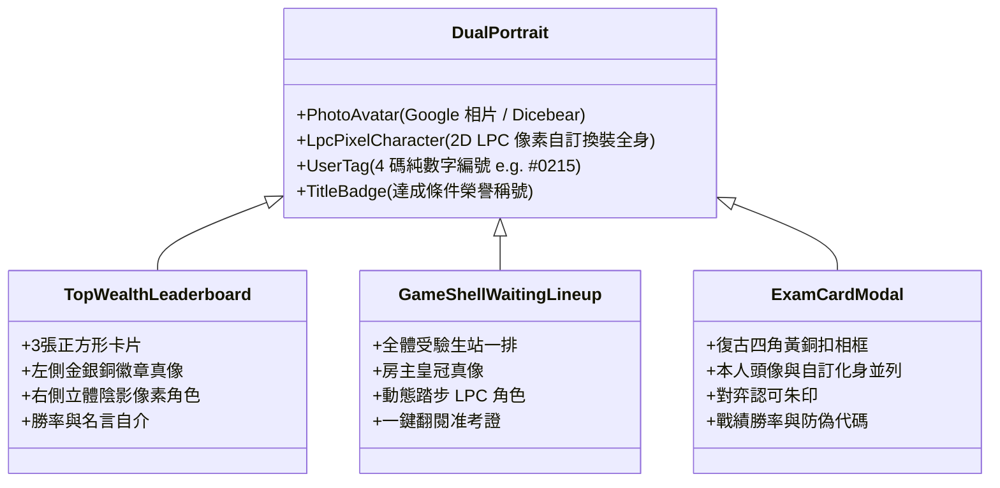
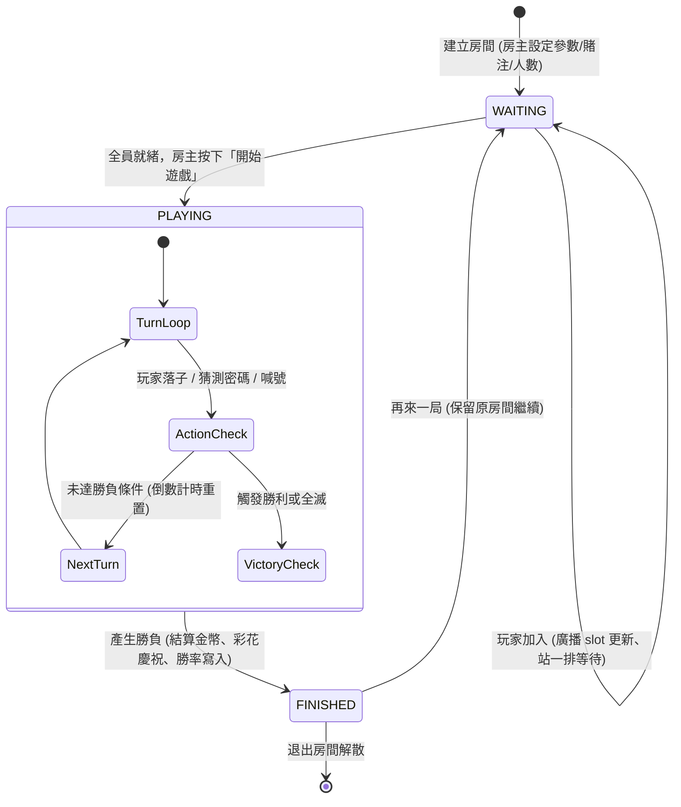

# 《遊戲室》(Game Room) 完整系統架構設計文件

本文件詳細闡述《遊戲室》(Game Room) 的整體架構、模組切分、狀態機流轉、Universal LPC 2D 像素換裝引擎、即時同步機制與雲端整合設計。

---

## 1. 系統架構總覽 (Architecture Overview)

《遊戲室》採用 **以現代前端為核心、以 Firebase RTDB 為即時訊息匯流排、以 Cloudflare R2 為靜態媒體邊緣儲存** 的無伺服器 (Serverless / BaaS) 雙向即時對戰遊戲架構。

```mermaid
graph TD
    UserClient[Web / PWA 客戶端 (React 18 + Vite)] -->|WebSocket 即時同步| RTDB[Firebase Realtime Database]
    UserClient -->|Google OAuth SSO| FBAuth[Firebase Authentication]
    UserClient -->|頭像自動遷移上傳| CFR2[Cloudflare R2 CDN 邊緣儲存]
    UserClient -->|單人模式跳轉| Single1A2B[1A2B 單人專用版 (1a2b.terry0215.com)]

    subgraph 前端應用層 (Client Application)
        UI[Tailwind CSS 毛玻璃昭和復古視覺]
        Sound[Web Audio API 合成音效引擎]
        LPCEngine[Universal LPC 2D 像素渲染引擎]
        MatchState[房間與對弈狀態機 (Room Context)]
        AuthState[用戶身份與個人檔案 (Auth Context)]
    end

    subgraph 雲端即時資料庫 (Firebase RTDB Nodes)
        RoomsNode["/rooms/{roomId} (對弈棋局與回合狀態)"]
        UsersNode["/users/{uid} (個人檔案、金幣、自訂外觀、裝備稱號)"]
        PresenceNode["/presence/{uid} (即時心跳在線狀態)"]
        InvitesNode["/invites/{targetUid} (即時對戰邀請推播)"]
        CasinoLogsNode["/casino_logs/{logId} (賭場查帳與押注流水)"]
        CasinoSettingsNode["/settings/casino (賭場全局即時賠率與勝率)"]
        PricingNode["/settings/shop_pricing (全體服飾商城定價)"]
    end

    RTDB --> RoomsNode
    RTDB --> UsersNode
    RTDB --> PresenceNode
    RTDB --> InvitesNode
    RTDB --> CasinoLogsNode
    RTDB --> CasinoSettingsNode
    RTDB --> PricingNode
```

---

## 2. 目錄架構與模組職責

```
duo-arena/
├── public/
│   ├── assets/lpc/               # Universal LPC 2D 精靈圖庫 (576x256 及 64x64 縮圖)
│   │   ├── body/                 # 男女基礎身體、頭部與男女骨架精靈圖
│   │   ├── hair/                 # 髮型精靈圖 (短髮、馬尾、長髮、大波浪等)
│   │   ├── tops/                 # 上衣、襯衫、軍裝大衣、學院水手服、法師長袍
│   │   ├── bottoms/              # 長褲、制服短裙、牛仔褲、卡其褲
│   │   ├── shoes/                # 皮鞋、靴子、運動鞋
│   │   ├── hats/                 # 巫師帽、海盜帽、王冠、戰士頭盔
│   │   └── accessories/          # 眼鏡、披肩、單片眼鏡、面具
│   ├── icons/                    # PWA 應用程式圖示 (icon-192, icon-512, icon.svg)
│   ├── manifest.webmanifest      # PWA 漸進式網頁應用清單
│   └── sw.js                     # Service Worker 快取與離線快取控制 (v14)
├── src/
│   ├── components/
│   │   ├── admin/                # 管理員後台 (AdminDashboard: 房間監控、查帳日誌、賠率調整、商城定價)
│   │   ├── auth/                 # 登入與落地頁面 (LandingPage: Google SSO 登入)
│   │   ├── casino/               # 帝國遊技場 (CasinoModal: 復古拉霸機、刮刮樂九宮格)
│   │   ├── common/               # 全域共用組件 (Header, ErrorBoundary, RuleDrawer, Sound, PWA Prompt)
│   │   ├── games/                # 六大對戰棋局
│   │   │   ├── battleship/       # 海戰棋艦隊對決 (6x6~10x10、迷霧、雷達轟炸、擊沉判定)
│   │   │   ├── bingo/            # 賓果 5x5 連線 (2~5人多人、自選洗牌、即時喊號)
│   │   │   ├── blackjack/        # 21點備用模組
│   │   │   ├── connect4/         # 四子棋連線爭霸 (7x6 垂直重力、連四星判定)
│   │   │   ├── dotsandboxes/     # 點線棋圍地方格 (2~3人、連續獎勵回合)
│   │   │   ├── game1a2b/         # 1A2B 數字密碼戰 (雙人互出題 / 多人競猜、單人導外)
│   │   │   ├── ooxx/             # 經典無限 OOXX (3子呼吸循環、消逝防和局機制)
│   │   │   └── GameShell.tsx     # 對戰容器與等待大廳 (全體受驗生站一排、雙重肖像展示、名片彈窗)
│   │   ├── lobby/                # 大廳主視圖
│   │   │   ├── Lobby.tsx         # 大廳入口 (遊戲卡片、開房、單人玩法導外、受驗名片入口)
│   │   │   ├── TopWealthLeaderboard.tsx # 帝國財富排行榜 TOP 3 (金銀銅正方形雙展示卡片)
│   │   │   ├── FriendsModal.tsx  # 好友管理 (4位數 Tag 搜尋、名片查看)
│   │   │   ├── FriendsSidebar.tsx# 好友側邊懸浮抽屜
│   │   │   ├── InviteFriendsModal.tsx # 房間內在線好友邀請
│   │   │   ├── RoomConfigModal.tsx   # 房間遊玩參數與單人導外推薦設定
│   │   │   └── RoomCodeKeypadModal.tsx # 6位數房間號螢幕虛擬數字鍵盤
│   │   └── profile/              # 受驗生個人檔案與換裝系統
│   │       ├── EditProfileModal.tsx   # 暱稱與 4 位數自訂 Tag 編輯
│   │       ├── ExamCardModal.tsx      # 帝國受驗生准考證 (復古四角黃銅扣相框、真像與角色雙展、朱印)
│   │       ├── LpcAvatarView.tsx      # LPC Canvas 角色渲染視圖 (支援動態行走與靜態站立)
│   │       ├── LpcWardrobeModal.tsx   # 2D 全身像素自訂換裝室 (部位分類、即時試穿、金幣購買、原樣還原)
│   │       ├── ProfileSetupModal.tsx  # 初次登入必填資料與隨機 4 位 Tag 初始化
│   │       └── TitleSelectorModal.tsx # 榮譽稱號佩戴選擇器 (達成條件自動解鎖)
│   ├── context/
│   │   ├── AuthContext.tsx       # 全域認證、使用者存檔、金幣交易流水、R2 自動遷移、全域在線廣播
│   │   └── RoomContext.tsx       # 即時對戰房間管理 (建立/加入/離線重連/即時落子廣播)
│   ├── data/
│   │   ├── lpcCatalog.ts         # Universal LPC 素材清單 (40+ 款上衣、褲裝、髮型、圖層權重、色盤定義)
│   │   ├── titleCatalog.ts       # 榮譽稱號定義清單 (達成條件、金銀銅漸層樣式)
│   │   └── wardrobeCatalog.ts    # 准考證朱印印記資料庫
│   ├── services/
│   │   ├── firebase.ts           # Firebase 實例初始化 (Auth, RTDB, Firestore)
│   │   ├── lpcRenderer.ts        # 自研 Universal LPC 像素級畫布繪製與即時色盤更換引擎
│   │   ├── matchService.ts       # 好友與即時對戰邀請推播服務
│   │   ├── r2Service.ts          # Cloudflare R2 輕量化 CDN 上傳服務
│   │   ├── soundService.ts       # Web Audio API 純程式合成音效引擎 (零外部載入延遲)
│   │   ├── itemPricingService.ts # 商城服飾動態價格快取與讀寫
│   │   └── casinoSettingsService.ts # 賭場全局勝率與查帳日誌服務
│   ├── types/
│   │   └── index.ts              # 全局 TypeScript 介面定義 (UserProfile, Room, LpcConfig, GameId 等)
│   └── utils/
│       └── userTag.ts            # 4 碼純數字代碼保證格式化工具 (防 UID 英文亂碼穿透)
```

---

## 3. Universal LPC 2D 像素角色渲染引擎 (`lpcRenderer.ts`)

本專案拒絕採用 iframe 外部嵌入方式，而是直接使用 Universal LPC (Liberated Pixel Cup) 開源精靈圖標準，在客戶端構建獨立的 JavaScript 角色合成引擎。

### 3.1 圖層堆疊順序 (Z-Index Layer Priority)
為解決像素服飾穿戴時衣服被身體遮擋、褲子蓋住鞋子等層級紊亂問題，引擎定義了嚴密的圖層權重：

```typescript
export const LPC_LAYER_PRIORITY = {
  behind_body: 5,   // 背部披風、背後斗篷 (位於身體後方)
  body: 10,          // 身體基底軀幹 (男性/女性骨架)
  head: 15,          // 頭部人臉特徵
  bottom: 20,        // 褲子、短裙、下身護甲
  shoes: 25,         // 靴子、皮鞋、鞋履 (覆蓋褲腳)
  top: 30,           // 上衣、襯衫、長袖上著 (覆蓋下身褲腰)
  jacket: 35,        // 風衣外套、皮夾克、長袍 (覆蓋上衣)
  hair: 50,          // 髮型 (覆蓋大部分面容與上身後緣)
  hat: 60,           // 帽子、頭盔、王冠 (覆蓋髮型頂部)
  accessories: 70    // 眼鏡、護目鏡、面具、圍巾 (最頂層)
};
```

### 3.2 即時像素級調色盤替換 (Pixel-Level Palette Recoloring)
LPC 原始素材以基礎色為基準（髮型為紅髮基準色盤、皮膚為 light 基準色盤）。引擎利用離線 Canvas 與 `willReadFrequently: true` 上下文進行像素替換：
1. 提取目標色盤與基準色盤的 RGB 容錯距離（Tolerance = 12）。
2. 在 CPU Canvas 中逐像素比對，將原色映射為目標色盤（支援 4 種膚色與 8 種髮色）。
3. 替換結果存入 `recoloredCache` 記憶體快取，同一件服飾二次換色或行走循環時達到 $O(1)$ 毫秒級極速重繪。

### 3.3 幀裁切與相機視角
- **標準行走圖**：576 × 256 px（4 方向 × 9 幀，每幀 64 × 64 px）。
- **方向映射**：Row 0 = Up, Row 1 = Left, Row 2 = Down (正面), Row 3 = Right。
- **清晰度保證**：畫布強制宣告 `ctx.imageSmoothingEnabled = false` 與 CSS `image-rendering: pixelated`，放大至 2x ~ 4x 依然保持純粹銳利的 8-bit 像素美感。

---

## 4. 雙重肖像 (Dual Portrait) 表現架構

為滿足玩家「辨識真人好友」與「彰顯像素角色個性格調」的雙重需求，本架構在三大關鍵場景全面實裝雙重肖像：



---

## 5. 即時房間狀態機與對弈架構 (`RoomContext.tsx`)

所有遊戲房間均為多玩家分布式狀態，由房主或伺服器寫入 RTDB，所有成員監聽：



---

## 6. 雲端儲存與巨量封包優化 (`r2Service.ts`)

### 問題痛點
傳統 Firebase 使用者頭像若直接以 Base64 字串存入 RTDB，每位玩家體積高達 2.6 MB。每當房間同步或在線狀態變更時，全體用戶都會收到巨型 JSON 封包，導致行動裝置掉幀、連線卡頓。

### 解決方案
1. **自動檢測與即時遷移**：
   在 `AuthContext` 偵測到用戶相片為 `data:image/` 開頭時，前端立即生成輕量佔位圖，並非同步上傳至 Cloudflare R2 邊緣儲存。
2. **邊緣 CDN 網址回寫**：
   上傳完成後取得全域 CDN 網址（如 `https://cdn.terry0215.com/avatars/{uid}.webp`），將 RTDB 的 `photoURL` 置換為 60 字元的超輕量網址。
3. **成果**：封包體積由 **2,600 KB 驟降至 0.06 KB**，頻寬消耗降低 99.9%，徹底消除對戰同步延遲。

---

## 7. 安全性與環境變數規範

- **環境配置 (`.env`)**：
  - `VITE_FIREBASE_API_KEY`、`VITE_FIREBASE_AUTH_DOMAIN`、`VITE_FIREBASE_DATABASE_URL`、`VITE_FIREBASE_PROJECT_ID`
  - `VITE_CF_R2_PUBLIC_DOMAIN`、`VITE_CF_R2_UPLOAD_ENDPOINT`
- **代碼安全**：
  - `getCleanUserTag()` 確保任何未初始化的老舊帳號均以確定性演算法映射為 4 位數字，杜絕 UID 私密字串外洩。
  - 管理員面板 (`AdminDashboard`) 具備 Role-Based 雙重校驗（AuthContext `role === 'admin'` 與 RTDB 節點許可權規則）。
